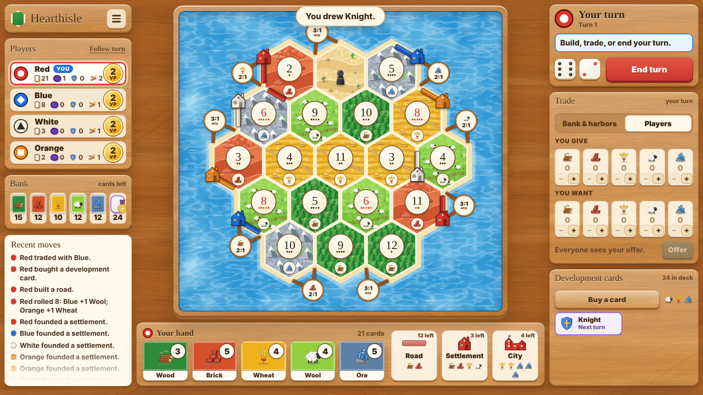

# Hearthisle

**A Catan-style island board game I built for the browser**, so my friends and I can play together for free.

Settle an island, roll for resources, trade with each other and the bank, build roads, settlements and cities, and race to 10 victory points. It plays by the classic base-game rules for 3–4 players and the 5–6 player extension, on a bright, hand-drawn, honey-oak tabletop.



> Hearthisle is a fan-made hobby project inspired by the board game *Catan*. It is not affiliated with or endorsed by Catan GmbH or its publishers. All artwork, icons and pieces in this repository are original.

## What's in it

- **The full base game:** 19-tile island (30 tiles for 5–6 players), number discs, harbours, the robber, a finite bank, development cards (Knight, Road Building, Year of Plenty, Monopoly, Victory Point), Longest Road and Largest Army.
- **Correct turn flow:** snake-order opening placements, discarding half on a 7, piece limits (15 roads, 5 settlements, 4 cities), and the paired turns used for 5–6 players.
- **Trading:** bank and harbour ratios (4:1, 3:1, 2:1), plus offers between players with accept, decline and counteroffer.
- **One screen, no scrolling:** the board, your hand, the bank, players, trading and dev cards all fit at once, down to a 1280×720 laptop.
- **Original art:** illustrated terrain tiles, detailed resource icons, and wooden pieces in six colours (Red, Blue, White, Orange, Green, Purple). Each colour also has its own symbol so nobody gets mixed up.
- **Online rooms:** create a room, send the link, and everyone plays from their own computer (a laptop or desktop works best for now). Each player picks one of six colours (a colour can't be taken twice), or joins as a spectator. Refreshing the page puts you back in your seat.
- **Fair hidden hands:** the server runs the game and only ever sends you your own cards. Everyone else's hands are just counts.

## Play online with friends

1. Open the game and type your name, then **Create a room**.
2. **Copy link** and send it to your friends (or tell them the 4-letter room code). When they open it, it asks their name first.
3. Everyone picks a colour. Anyone who just wants to watch picks **Just watch**.
4. The host chooses how opening settlements are placed and presses **Start game** (3–6 players).

## Put it online for free (Render)

The game runs as one small Node server, which fits [Render's free plan](https://render.com/docs/free).

1. Sign in to [render.com](https://render.com) with this GitHub account.
2. Choose **New → Blueprint** and pick this repository. Render reads `render.yaml` and sets everything up.
3. When it's live you get a link like `https://hearthisle.onrender.com`. Share that.

Free-plan notes: the server sleeps after 15 minutes with nobody connected, so the first person to open the link may wait up to a minute while it wakes. It stays awake while a game is being played.

**Games survive restarts.** Render can restart a free server at any time, and pushing new code restarts it too. After every move the server gives each player's browser a sealed backup of the game (encrypted with a secret only the server knows, so nobody can read or edit it). If the server restarts, everyone's screen reconnects on its own, the first browser back hands over its backup, and the game continues from the last move. A crash in one message is logged and ignored instead of stopping the server.

## Run it on your computer

Requires [Node.js](https://nodejs.org) 22.13 or newer.

```sh
npm install
npm start
```

Open http://localhost:5174. To try several players at once, open the room link in different browsers or private windows. Friends on the same Wi-Fi can join using your computer's local IP address and port 5174.

```sh
npm test   # rule and room tests
```

## How it's built

Plain HTML, CSS and JavaScript modules with a small Node server: no frameworks. The only dependency is [`ws`](https://github.com/websockets/ws) for live connections.

| File | Job |
| --- | --- |
| `public/js/rules.js` | Every game rule as pure functions (state in, new state out). No DOM, so the same file can run on a server. |
| `public/js/geometry.js` | Hexes, corners, edges and harbours for both island sizes. |
| `public/js/view.js` | Draws the game from one seat's point of view. |
| `public/js/pieces.js` | The wooden roads, settlements, cities and robber, drawn per player colour. |
| `public/js/main.js` | Connects to the room, sends your moves, and redraws when the server updates. |
| `public/css/art.css` | The only file that points at artwork, so the art can be swapped without touching the code. |
| `public/art/` | Terrain tiles, wood, sea and paper textures, and icons (all SVG). |
| `server.mjs` | Serves the game and runs the WebSocket connection, with a strict content security policy. |
| `server/rooms.mjs` | Rooms, colour picking, spectators, turn checks, and hiding other players' hands. |
| `server/snapshots.mjs` | Sealed game backups that let a game survive a server restart. |
| `render.yaml` | Free hosting setup for Render. |
| `test/` | Rule tests with Node's built-in test runner. |

## Rules coverage

| | 3–4 players | 5–6 players |
| --- | --- | --- |
| Land tiles | 19, including 1 desert | 30, including 2 deserts |
| Number discs | 18 | 28 |
| Harbours | 9 | 11 |
| Resource supply | 19 of each | 24 of each |
| Development deck | 25 | 34 |
| Each player's pieces | 15 roads, 5 settlements, 4 cities | Same |
| Victory | 10 points on your own turn | Same |

For 5–6 players, Player 1 rolls and acts, then the player three seats to their left takes an action-only turn (no rolling, no player trades).

## Roadmap

- [x] Full rules engine with tests
- [x] One-screen bright wooden interface
- [x] Online rooms: share a link, pick your colour, or spectate
- [x] Free hosting setup (Render)
- [ ] Phone-sized layout
- [ ] In-game chat
